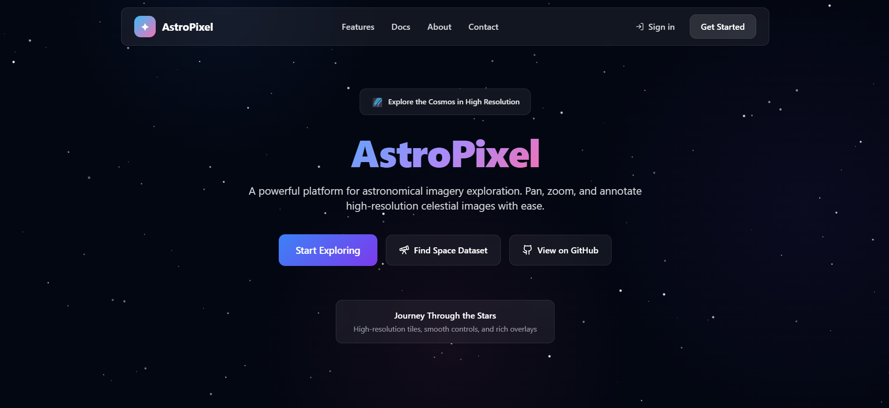
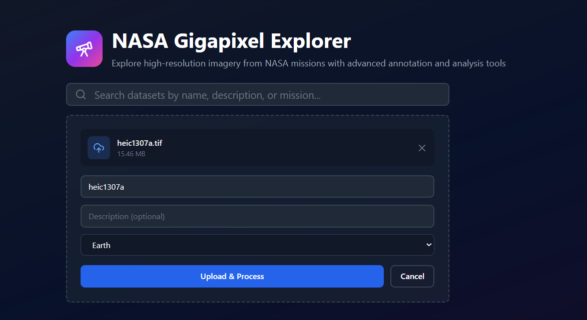

# AstroPixel

AstroPixel is a FastAPI + React platform for exploring NASA gigapixel imagery with buttery-smooth deep zoom, annotations, and secure user/admin workflows. It ingests GeoTIFF/PSB files, generates tile pyramids with GDAL, and serves them through an optimized viewer.

## Overview

- Purpose-built for planetary and space imagery: upload, tile, and explore at gigapixel scale.
- Modern stack: FastAPI backend, React/Vite frontend, OpenSeadragon viewer, optional Cloudflare R2 storage.
- Production-minded: Docker-ready, CI/CD workflows, issue/PR templates, and deployment guides.

## Features

- Viewing: Deep-zoom OpenSeadragon viewer for 100B+ pixel imagery; smooth pan/zoom and tile caching.
- Ingestion: GeoTIFF/PSB upload, GDAL-based tile pyramid generation, thumbnails/previews.
- Annotations: Points/regions with persistent storage; per-user auth; admin review.
- Auth & Roles: JWT authentication, admin panel, role-based access controls.
- Storage: Local filesystem or Cloudflare R2 (S3-compatible) for tiles/uploads.
- Ops: Health endpoints, rate limiting middleware, ready-to-run Dockerfile and compose.

## Tech Stack

- Backend: FastAPI, SQLAlchemy, GDAL, PostgreSQL/SQLite, Uvicorn
- Frontend: React 18, Vite, Tailwind CSS, OpenSeadragon
- Infra: Docker, GitHub Actions CI, optional Cloudflare R2, Hugging Face Spaces ready

## Quick Start

### Backend

```bash
cd Backend
conda create -n astropixel python=3.11 gdal -c conda-forge
conda activate astropixel
pip install -r requirements.txt
python create_admin.py
uvicorn app.main:app --host 0.0.0.0 --port 8000 --reload
```

### Frontend

```bash
cd Frontend
npm install
npm run dev
```

### Environment

Copy `Backend/.env.example` to `Backend/.env` and replace every placeholder. Startup requires:

- `DATABASE_URL`: an explicit SQLAlchemy URL for the intended PostgreSQL or SQLite database.
- `SECRET_KEY`: a unique random value of at least 32 characters. Generate one locally with `python -c "import secrets; print(secrets.token_urlsafe(48))"`.
- `DB_PASSWORD`: required by Docker Compose and must match the password in the Compose `DATABASE_URL`.

Keep `Backend/.env` private and do not commit it. For the frontend, copy `Frontend/.env.example` to `Frontend/.env.local` and set `VITE_API_BASE_URL`; frontend `VITE_*` values are public and must never contain backend secrets.

## Deployment

- Backend: Dockerfile provided; `docker-compose.yml` for local stack.
- Hugging Face Spaces: works out of the box when secrets are set (DATABASE_URL, SECRET_KEY, R2 keys).
- Reverse proxy: run Uvicorn behind Nginx/traefik for TLS and caching.

## Screenshots

- Reference them here:
  
  

## Repository Structure

- `Backend/` — FastAPI app, services, routers, Dockerfile
- `Frontend/` — React/Vite client

## License

This project is licensed under the MIT License - see the [LICENSE](LICENSE) file for details.

Copyright (c) 2025 Jayant Sunil Potdar
